# Assignment 6 - jQuery Portfolio

**Name:** Saken Zhadiger  
**Group:** SE-2538

A personal portfolio built with HTML, CSS and jQuery.

Open `index.html` in a browser. An internet connection is required to load jQuery from the CDN.

## Part 1 - Getting Started with jQuery

### Task 0 - Setup

The full version of jQuery 3.7.1 is loaded from the CDN before `script.js`. The `$(document).ready()` function prints `jQuery is ready!` in the browser console.

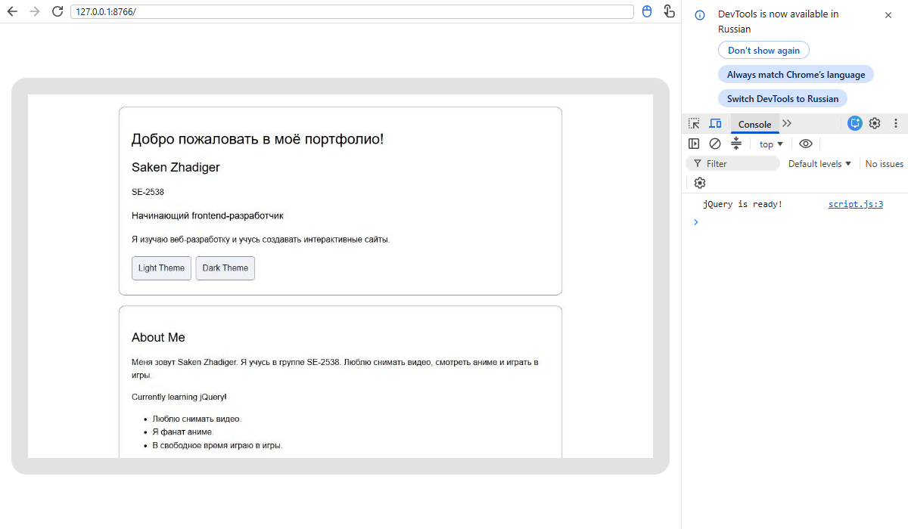

### Task 1 - Selectors and CSS

The profile includes my name, group, headline and introduction. Tag, ID and class selectors select elements. The `.text()` method changes the greeting, and `.css()` changes styles. The Light Theme and Dark Theme buttons change the background and text colors.

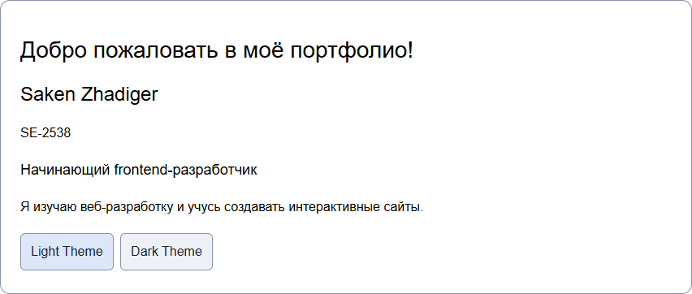

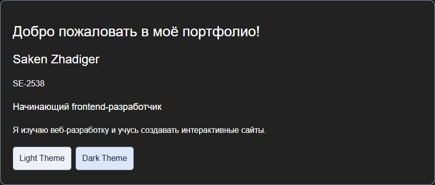

## Part 2 - jQuery Effects

### Task 2 - Visibility Methods

The About Me section includes a biography, status and personal facts. Hide, Show and Toggle control the status using `.hide()`, `.show()` and `.toggle()`.

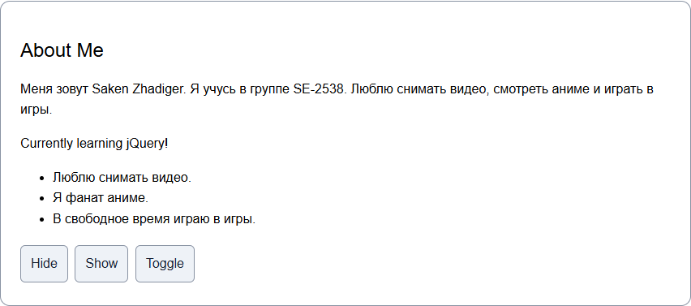

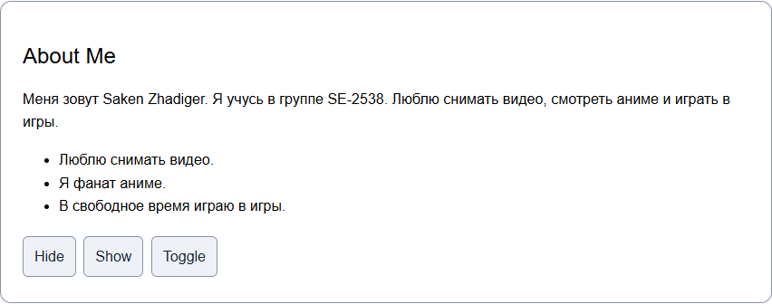

### Task 3 - Fade Methods

The gallery contains two photos. Fade In, Fade Out and Fade Toggle use `.fadeIn()`, `.fadeOut()` and `.fadeToggle()` to show or hide them gradually.

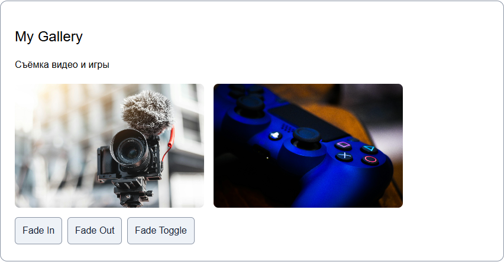

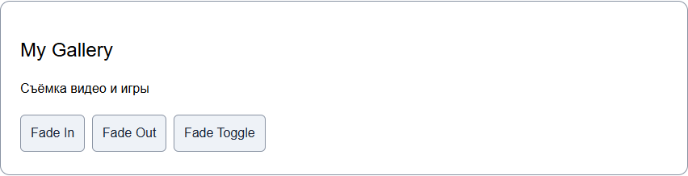

### Task 4 - Slide Methods

Three clickable headings open and close their panels using `.slideToggle()`. Open All uses `.slideDown()`, and Close All uses `.slideUp()`. The panels are hidden when the page loads.

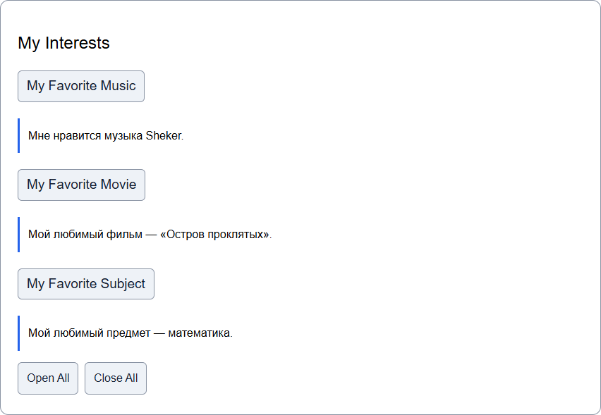

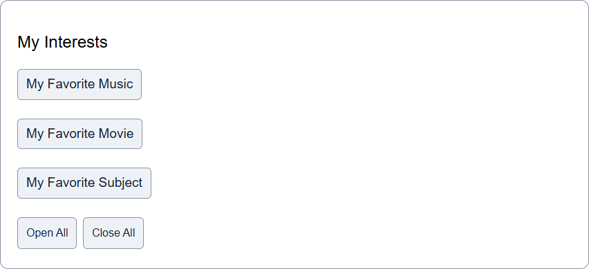

## Part 3 - DOM Manipulation with jQuery

### Task 5 - Add and Remove Elements

The initial skills are HTML, CSS, JavaScript and Git. Add Skill adds an item to the end using `.append()`. Prepend Skill adds it to the beginning using `.prepend()`. Remove Skill deletes the last item using `.remove()`. Empty input and spaces are rejected with `.trim()`. New items use `.text()` to display input as plain text.

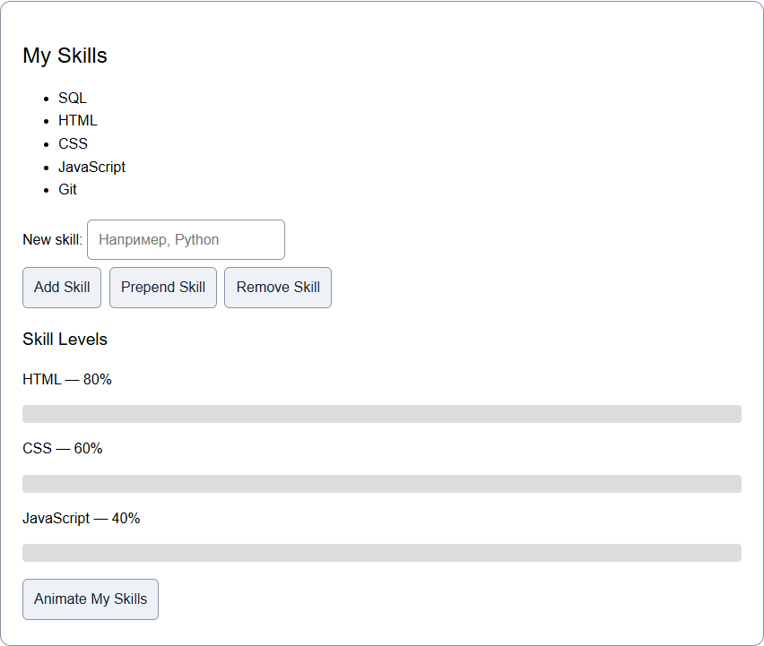

### Task 6 - Modifying Attributes

Change Link updates the link from my profile to my repository list using `.attr("href", ...)`. The `.text()` method also changes the link label.

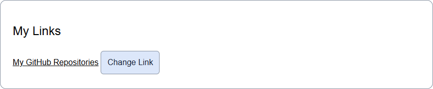

### Task 7 - Form Interaction

The Name and Email fields use the `input` event. Their values are read with `.val()` and displayed below the form with `.text()`. The form does not send data to a server.

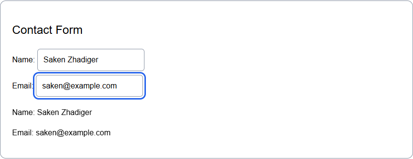

## Part 4 - Animations

### Task 8 - Basic Animation

Three skill bars start at zero width. Animate My Skills uses `.animate()` to increase their widths to 80%, 60% and 40%. A second click returns them to zero. The `skillsVisible` variable and an `if / else` statement control the direction. The percentages are sample values.

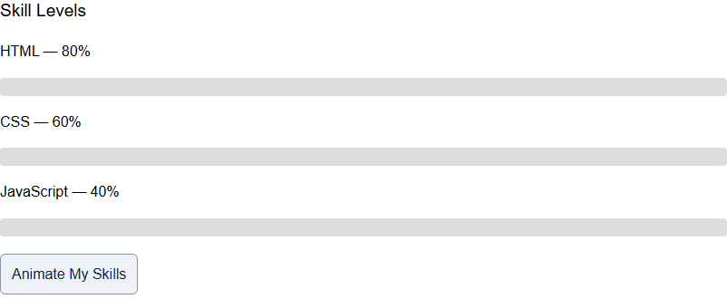

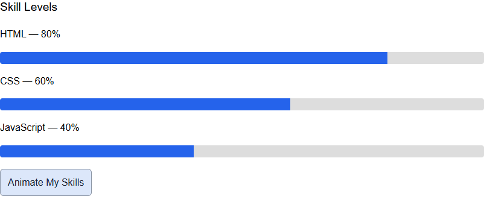

## Work Process Summary

The page layout and CSS were prepared first. jQuery was then added for buttons, effects, skill editing, links, form input and animations. The controls, empty input and animation reset were checked. Screenshots show the results for each task.

## Photo Credits

- [Camera photo by Christian Wiediger](https://unsplash.com/photos/black-dslr-camera-wtmpzTgJEbU).
- [Controller photo by ENG-HS](https://unsplash.com/photos/a-close-up-of-a-video-game-controller-PWOi85KoDE8).

